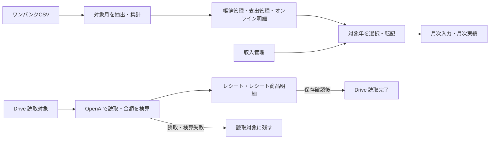
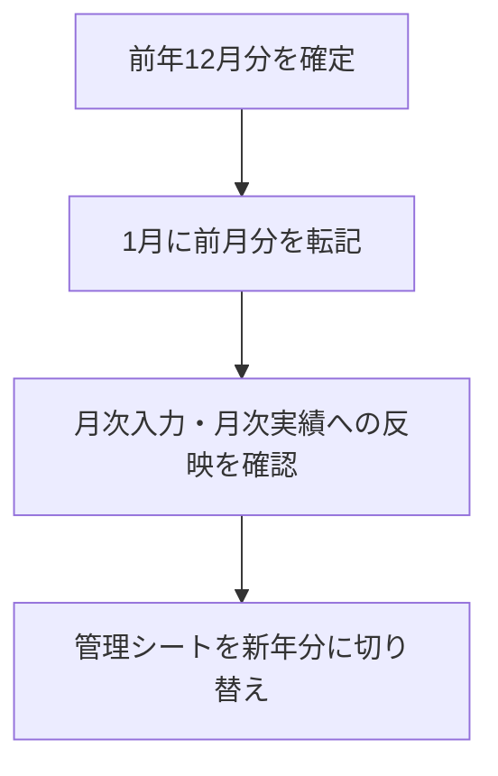

# ワンバンク連携 家計簿（gas-kakeibo-app）

ワンバンクのCSVをGoogleスプレッドシートで月別・カテゴリ別に集計する、Google Apps Script（GAS）の家計簿です。Google Driveに置いたレシート画像から購入品を記録する機能と、月別の集計結果を年単位で保存する機能もあります。

## 目次

- [データの流れ](#データの流れ)
- [セットアップ](#セットアップ)
- [ワンバンクCSVを取り込む](#ワンバンクcsvを取り込む)
- [分割払いを管理する](#分割払いを管理する)
- [レシートから購入品を記録する](#レシートから購入品を記録する)
- [月別データを月次入力・月次実績に転記する](#月別データを月次入力月次実績に転記する)
- [通知とグラフ](#通知とグラフ)
- [よくあるエラー](#よくあるエラー)
- [主なソース](#主なソース)

## データの流れ



CSVは毎月の支出集計に使います。レシートは購入品の内訳を記録し、支出総額への加算は行いません。「帳簿管理」の収支結果一覧では、現行シートの今年分を上部の月別データから、前年分を「月次実績」から集計します。この一覧の数式はスプレッドシート側で管理しています。

### シートの役割

| シート | 用途 |
|---|---|
| 帳簿管理 | 月別収支の確認、入金額の入力、CSV取込月の指定 |
| 収入管理 | 月別・項目別の収入管理 |
| 支出管理 | 月別・カテゴリ別の支出管理 |
| オンライン明細 | オンライン支出の店舗別内訳 |
| 分割払い管理 | 支払総額、分割回数、引落予定の管理 |
| 月次入力・月次実績 | 転記済みの入金・収支の保存 |
| レシート・レシート商品明細 | 会計単位の情報と商品別の明細 |
| 設定・ログ | 利用者名やショップ分類の設定、CSV処理の記録 |

## セットアップ

1. 家計簿のスプレッドシートから **拡張機能 → Apps Script** を開きます。スプレッドシートに紐づいたプロジェクトを使うと、編集時のグラフ更新も利用できます。
2. このリポジトリの `.gs` ファイルを反映します。既存の家計簿へ更新する場合は、先にクラウド側にだけあるファイルや変更を確認してください。
3. Apps Scriptの **プロジェクトの設定 → スクリプト プロパティ** で、使う機能に応じて以下を設定します。スクリプトとスプレッドシートは日本時間（`Asia/Tokyo`）で運用します。
4. 使う機能を手動で一度試し、必要な権限を承認します。定期実行が必要な機能は、Apps Scriptの **トリガー** 画面で時間主導型トリガーを追加し、実行間隔を選びます。

### スクリプト プロパティ

| 名前 | 設定する値・用途 |
|---|---|
| `SPREADSHEET_ID` | 家計簿URLの `/d/` に続くID。CSV取込、レシート取込、通知などに使用 |
| `EMAIL_PRIMARY` | CSV取込結果、CSV配置依頼、バックアップ依頼の通知先 |
| `EMAIL_SECONDARY` | ソースで読み込む予備のメールアドレス。現行のメール送信では未使用 |
| `OPENAI_API_KEY` | レシート画像の読み取りと家計分析コメントに使用 |
| `LINE_ACCESS_TOKEN` | LINEの振込依頼を使う場合のチャネルアクセストークン |
| `RECEIPT_INBOX_FOLDER_ID` | Driveの「読取対象」フォルダのID |
| `RECEIPT_DONE_FOLDER_ID` | Driveの「読取完了」フォルダのID。読取対象とは別のフォルダを指定 |
| `RECEIPT_OPENAI_MODEL` | レシート読取用モデル。省略時は `gpt-4.1-mini` |

フォルダIDはDriveのURLの `/folders/` に続く部分です。APIキー、アクセストークン、接続先のプロジェクト設定はGitHubにコミットしないでください。

### WindowsのVS Codeから反映する場合

初回は `git clone https://github.com/zawawa0722/gas-kakeibo-app.git` で取得し、作成された `gas-kakeibo-app` を開きます。以後、作業中の変更を確認してからリポジトリ内で実行します。

```powershell
git status -sb
git pull --ff-only origin main
```

`clasp.cmd` を使う場合は、`.clasp.json` の `scriptId` に **Apps ScriptのスクリプトID**を設定します。スプレッドシートIDとは別です。`.clasp.json` が親フォルダにある構成では、`rootDir` に `gas-kakeibo-app` を指定します。

このリポジトリのマニフェストは `appsScript.json` という名前です。claspに送るローカルコピーでは **`appsscript.json`** にします。Windowsで大文字・小文字だけを変える場合は、いったん `appsscript-temp.json` などの別名を経由してください。

```powershell
clasp.cmd status
clasp.cmd push
```

先に `status` を実行し、`appsscript.json` と必要な `.gs` が **Tracked files** に並ぶことを確認してから `push` します。GitHubからの取得で更新されるのはPC上のファイルで、GASへの反映は `push` で行います。

| 操作 | 実行場所 | 確認すること |
|---|---|---|
| `git status -sb`、`git pull --ff-only origin main` | `gas-kakeibo-app` フォルダ | 現在のブランチが `main` で、作業中の変更を把握していること |
| `clasp.cmd status`、`clasp.cmd push` | `.clasp.json` のあるフォルダ | `scriptId` が更新対象のGASを指し、必要なファイルがTracked filesにあること |

`--ff-only` は、手元のブランチをそのまま進められる場合に更新します。手元とGitHubで別々のコミットが増えて履歴が分かれた場合は、作業中の変更と履歴を確認してください。

## ワンバンクCSVを取り込む

1. Google Driveに `ワンバンク` フォルダを用意し、対象年のCSVを `ワンバンク支出_YYYY.csv` として置きます。例は `ワンバンク支出_2026.csv` です。
2. 「設定」シートのA列をキー、B列を値として、`USER_A_NAME` と `USER_B_NAME` を設定します。D列は楽天市場扱いのショップ、E列はその他オンライン扱いのショップの設定です。
3. 手動で対象月を指定する場合は、「帳簿管理」の `A16`（年）と `B16`（月）を指定し、確認ダイアログ付きの `onButtonClick` を割り当てたボタンを押します。時間主導型トリガーでは `importCsv` を指定します。トリガー実行は前月分を取り込む想定です。

CSVの対象年月に一致し、支出対象フラグが `1` の行を集計します。年月の列を特定して「支出管理」「オンライン明細」に集計値を書き込みます。書き込み先に数式があるセルはスキップし、取込結果や警告は「ログ」や実行履歴で確認できます。

| 確認項目 | 内容 |
|---|---|
| 手動で取り込む月 | 「帳簿管理」の `A16`（年）と `B16`（月） |
| トリガーで取り込む月 | 実行日の前月。現行の月計算で日付の繰り越しを避けるため、月の前半に実行する |
| 取り込み条件 | CSVが8列で、日付欄が対象年月に該当し、7列目の支出対象フラグが `1` |
| 取込後の確認 | 「ログ」の件数と警告、支出管理・オンライン明細の対象月列 |

## 分割払いを管理する

1. 「分割払い管理」に購入日、商品名、利用カード、購入金額、支払総額、分割回数、初回引落日を入力します。分割変更日は変更があった場合に記録します。
2. 分割手数料は支払総額から購入金額を引いて求めます。支払済回数は初回引落日と今日の日付から求める予定ベースの回数です。
3. 「支出管理」の分割費で、初回引落月から最終引落予定月までの支払予定額を確認します。複数の契約がある月は合算されます。

月ごとの分割費は、支払総額を分割回数で割って円未満を切り捨て、端数を最終回に加えます。カード会社の実際の請求額とは月ごとに差が出る場合があります。この連携はスプレッドシートの数式で管理しています。

## レシートから購入品を記録する

1. Driveに「読取対象」と「読取完了」を用意し、両方のIDをプロパティに設定します。
2. 「レシート」「レシート商品明細」シートの見出しを次の順序で用意します。1行目は見出しです。
3. 「読取対象」に画像を置き、手動で `importReceiptsFromDrive` を実行します。定期処理する場合も、同じ関数を自分で設定したトリガーに指定します。
4. Apps Scriptの実行履歴、シートの追加行、画像の移動先を確認します。

| シート | 1行の単位 | 列の順序 |
|---|---|---|
| レシート | 会計1件 | レシートID、購入日時、店舗名、税抜小計、消費税、支払合計、支払方法、元画像、読取状態、照合状態、明細ID |
| レシート商品明細 | 商品または値引き1行 | レシートID、行番号、行種別、レシート上の表記、表示用商品名、数量、行金額、税込・税抜、税率、商品カテゴリ |

JPEG・PNG・WebPの画像はそのまま読み込みます。HEIC・HEIFはDriveのサムネイルが取得できる場合に読み込みます。HEICで文字が判読できない場合は、JPEGなどに変換してから再試行してください。画像は読み取りのためにOpenAI APIへ送信されます。

商品・値引き・税と支払合計を照合し、両シートへの保存を確認した画像を「読取完了」へ移します。読取や検算に失敗した場合は実行ログに理由を残し、画像は「読取対象」に残ります。同じDriveファイルIDの保存が完了済みなら、再実行時は画像の移動だけを試みます。

## 月別データを月次入力・月次実績に転記する

毎月の時間主導型トリガーに `migrateMonthlyActuals` を指定します。スプレッドシートのタイムゾーンを基準に、実行日の前月1か月分を転記します。前月分の入力とCSV取込を済ませ、転記元4シート（帳簿管理、収入管理、支出管理、オンライン明細）に対象月の列を残しておきます。

| 転記先 | 見出しの順序 | 内容 |
|---|---|---|
| 月次入力 | 対象月、ユーザーID、仮入金額、実入金額 | ユーザーごとの月別入金 |
| 月次実績 | 対象月、区分、カテゴリ、内訳、金額 | 月別の収入・支出。オンライン支出は店舗別 |

転記結果は既存のスクリプトプロパティ `EMAIL_PRIMARY` 宛てに送ります。成功時は対象月と転記先ごとの追加行数、失敗時は対象月とエラーの理由を知らせます。

転記前に収入・支出の内訳と合計を確認します。同じキーと金額の既存行はスキップし、金額が異なれば書き込みを止めます。オンライン支出は店舗別内訳を使い、小計の二重計上を防ぎます。

### 年が替わるときの運用



1月10日ごろを目安にする場合は、先に前年12月の入力とCSV取込を終えます。転記後に元データを修正すると、再実行時に既存行との金額差で止まります。差が出た年月とカテゴリを照合し、修正後の確定値を確認してください。

## 通知とグラフ

| 関数 | 用途 |
|---|---|
| `sendEmailRequestCsvStorage` | ワンバンクCSVをDriveに置くようメールで通知 |
| `sendEmailRequestBuckup` | 前年度実績のバックアップ作業をメールで通知 |
| `sendFamilyTransferRequest` | 前月の収支・振込依頼をLINEへ配信。家計分析コメントにはOpenAI APIを使用 |
| `onEdit` | 対象シートの年月セルを編集したとき、内訳グラフを更新 |

## よくあるエラー

| 症状 | 確認する場所 |
|---|---|
| `fatal: not a git repository` | VS Codeで、クローン時に作られた `gas-kakeibo-app` フォルダを開いているか確認 |
| `Project contents must include a manifest file named appsscript` | `clasp.cmd status` のTracked filesに小文字の `appsscript.json` があるか確認。なければファイル名と `rootDir` を確認 |
| CSVが見つからない・取り込む月が違う | Driveのフォルダ名、CSVの年、手動実行の年・月、シートの年月見出しを確認 |
| レシート画像が移動しない | 実行履歴で読取・検算・書き込み・Drive権限のどこで失敗したかを確認 |
| CSV取込後に金額が変わらない | 対象年月の見出し、ログの抽出件数、該当セルに数式が入っているかを確認 |
| 月次転記で内訳と合計が一致しない | エラーに出た年月の収入・支出の合計行と、オンライン明細の店舗別金額を照合 |

## 主なソース

| ファイル | 役割 |
|---|---|
| [config.gs](config.gs) | シート名、セル位置、支出カテゴリ、プロパティ |
| [initproc.gs](initproc.gs)・[checkProc.gs](checkProc.gs) | 設定・CSVの取得、対象月・出力先の確認 |
| [importCsv.gs](importCsv.gs) | ワンバンク明細の分類と月別集計 |
| [importReceipts.gs](importReceipts.gs) | レシートの読取、検算、保存、画像移動 |
| [migrateMonthlyActuals.gs](migrateMonthlyActuals.gs) | 前月分の月次入力・月次実績への転記 |
| [addGraph.gs](addGraph.gs) | グラフ更新 |
| [notification.gs](notification.gs)・[analyzeAi.gs](analyzeAi.gs)・[outputlog.gs](outputlog.gs) | メール・LINE通知、AIコメント、ログ |
